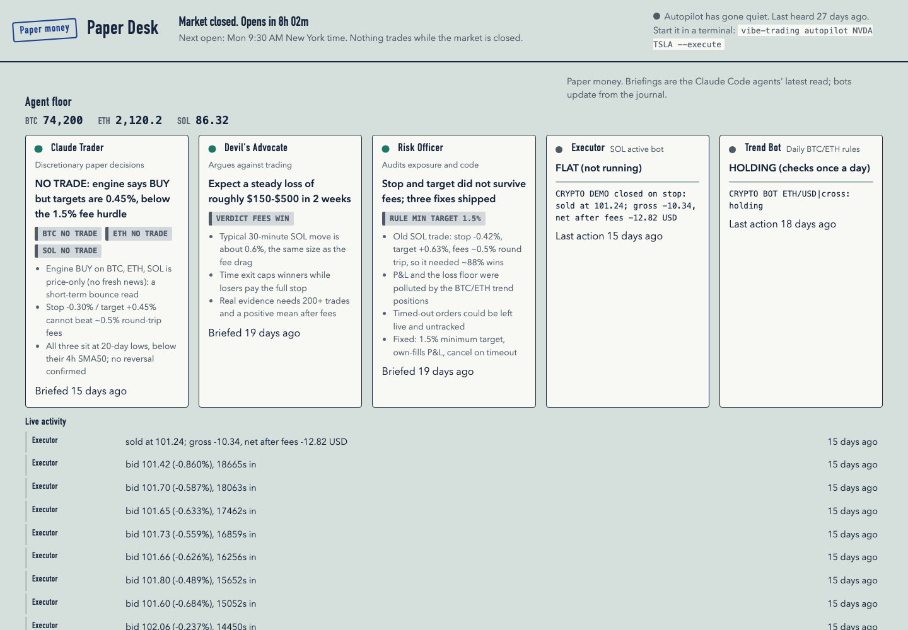

# Paper trading experiments

Paper-only experiments built on top of Vibe-Trading. **No real money is ever traded.** Every order goes to an
Alpaca paper account or a crypto demo, and any live order would have to pass `agent/src/live/sdk_order_gate.py`
with a mandate the user commits themselves.



*Paper Desk: a read-only dashboard (`cd agent && python -m src.desk`, then http://127.0.0.1:8765) showing the
agent floor, live bots and their journal.*

## What is here

| Piece | Where |
|---|---|
| Paper Desk dashboard | `agent/src/desk` |
| Alpaca paper autopilot and execution bridge | `agent/src/execution` |
| Crypto demo bot and daily trend bot | `agent/src/execution`, `agent/scripts` |
| Opening range breakout (ORB) bot for SPY and QQQ | `agent/src/execution/orb_bot.py`, `agent/scripts/orb_bot.py` |
| Managed one-off stock trade (safety stop, sell retries) | `agent/src/execution/manual_trade.py` |
| Pre-registered tests | `agent/scripts/PREREGISTRATION-*.md` |

## Method

Each test is written down **before** it runs (rules, sample size, pass/fail line), then judged on the
account's own fills. Nothing is tuned after seeing results.

## Results so far

| Test | Result |
|---|---|
| Crypto trend bot | Ended early, about -$240 realized |
| SOL demo bot | Net -$45.90 |
| Stock autopilot | About -$137 over 6 trades |
| Crypto timeframe study | No edge found |
| ORB paper test | 4 trades, net -$22.67. Needs 20+ trading days and 25+ trades before any verdict. Oct 29 started late (after the opening range) and is a protocol deviation. |

No strategy here has shown a profit after fees. Treat this as an engineering and honesty exercise, not a signal
service. It is not investment advice.

## Running it

```bash
cd agent
python scripts/orb_bot.py --execute        # one ORB session, paper only
python -m src.desk                         # dashboard
```

API keys come from `~/.vibe-trading/alpaca.json` or environment variables and are never committed.
